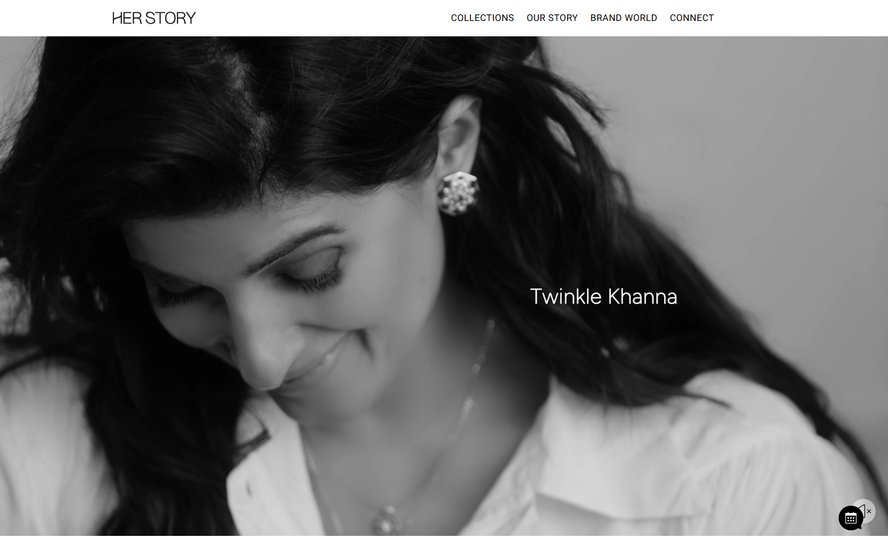

# Her Story — a birthday website



A single-page, cinematic birthday experience built with Next.js 16, React 19, TypeScript, Tailwind CSS v4, Framer Motion, and GSAP. Everything is client-rendered and static — no backend, no database.

**Live demo:** <https://herstory.vercel.app>

## Quick start

```bash
npm install
npm run dev        # http://localhost:3000
npm run build      # production build
npm run start      # serve the production build
```

## Make it yours

All personal content lives in `src/data/` — edit the text, never the components.

| File | What to change |
| --- | --- |
| `site.ts` | **Start here.** Names, birthday, intro lines, love letter, song title, secret easter egg, password gate, SEO. |
| `story.ts` | The "Our Story" timeline (date, title, description, image per entry). |
| `memories.ts` | Memory gallery photos + captions + dates. `ratio` is a Tailwind aspect (`video`, `square`, `portrait`, `tall`). |
| `favourites.ts` | "Little things you love" horizontal scroll (label, description, image). |
| `reasons.ts` | The 10 flip cards. Add or remove cards freely. |
| `polaroids.ts` | Polaroid wall (image, caption, rotation). |
| `future.ts` | "Places I want to take you" glowing stars. |
| `videos.ts` | Video memories (title, description, src, optional poster). |
| `types.ts` | Shared data shapes. You shouldn't need to touch this. |

### Photos

Drop your real photos into `public/images/` mirroring the structure:

- `hero/hero.jpg` — hero background
- `og.jpg` — the link-preview thumbnail (1200×630 works best)
- `story/s1.jpg … s4.jpg`
- `memories/m1.jpg … m12.jpg`
- `favourites/f1.jpg … f5.jpg`
- `polaroids/p1.jpg … p6.jpg`
- `final/final.jpg`
- `song/song-artwork.jpg`

Her real photos/videos from the zip are already wired in. Swap any of them by
overwriting the file at the same path, or drop different photos in and edit the
`src` in the matching data file.

### Song & video

The player and lightbox handle missing files gracefully, so they can be added later:

- `public/audio/our-song.mp3` — the music player auto-plays on first tap anywhere.
- `public/videos/` — add any mp4/webm and reference it in `videos.ts`.

## Little secrets

- **Easter egg:** tap the heart in the navbar the number of times set in
  `siteConfig.easterEgg.clicks`, then tap the heart again to reveal a hidden note.
- **Shuffle:** the "Reasons I Love You" cards have a shuffle button — the order
  re-randomises and the cards re-enter every time.
- **Ambience:** a romantic word ticker runs between the hero and the first
  section, and tiny sparkles follow the cursor and burst on click (both are
  disabled automatically for reduced-motion users).
- **Password gate:** optional client-side gate in `siteConfig.passwordGate`
  (defaults to off). This is a "keep prying eyes out of the UI" feature, not real security — the content is still in the page source.
- **Reduced motion:** respected everywhere (framer + CSS); the intro skips its staggered reveal.
- **Our song:** the player needs `public/audio/our-song.mp3`. The config already has the title and artist set ("I'm Not Gonna Lie" feat. Njilour).

## Deploying

The page is fully static. Run `npm run build`, then host `.next` with `npm run start` or deploy the project to Vercel/Netlify as you would any Next.js app.

Before sharing:

1. Set `siteConfig.metadata.siteUrl` to your real domain so WhatsApp/iMessage link previews resolve absolute URLs (it currently falls back to a placeholder domain).
2. Replace the placeholder photos with real ones and make sure `[HER NAME]`/`[MY NAME]` (including `siteConfig.final.credit`) never reaches her.